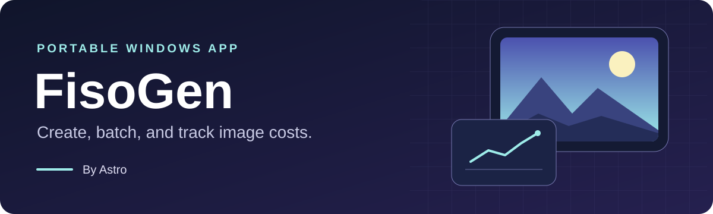
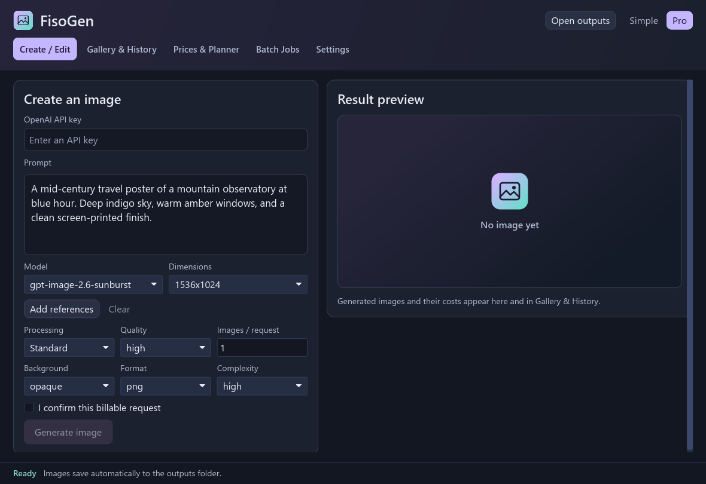
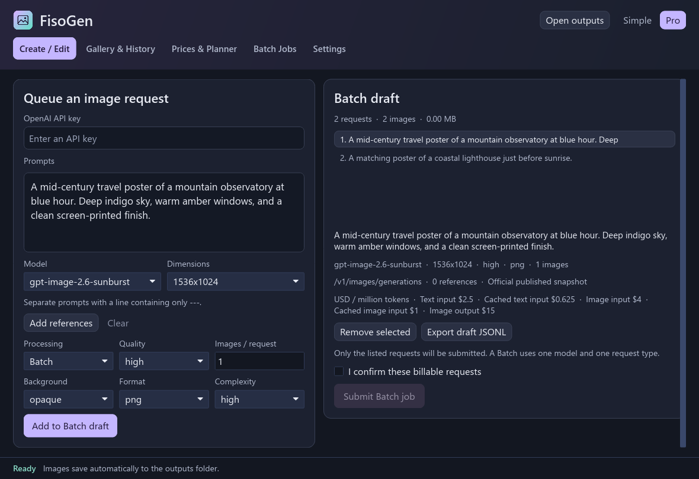
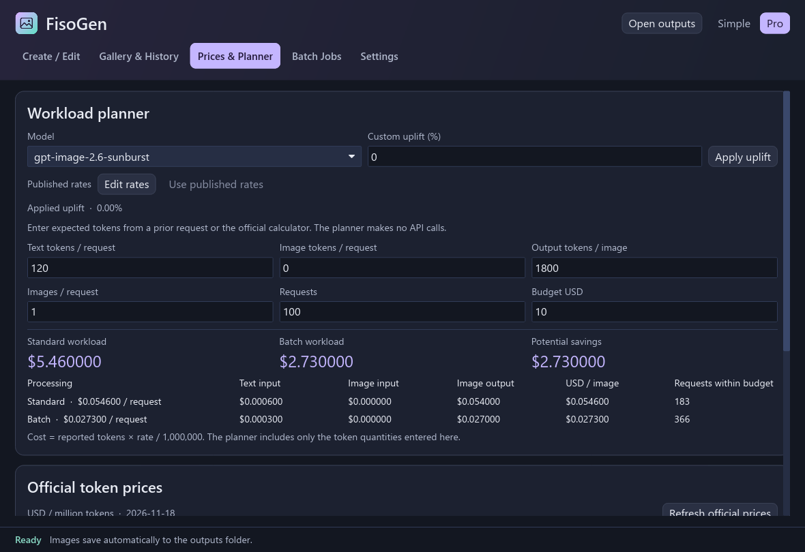

# FisoGen



**A portable Windows desktop app for generating and editing images with the OpenAI API, planning batch work, and tracking what requests cost.**

**[Download FisoGen for Windows x64](https://github.com/Astro1247/FisoGen/releases/latest/download/FisoGen.exe)** · [Screenshots](#screenshots) · [Quick start](#quick-start) · [Build from source](#build-from-source) · [Usage reference](docs/reference.md) · [MIT license](LICENSE)

## What you can do

| Workflow | What you get |
| --- | --- |
| **Create and edit** | Generate from a prompt, add reference images, and control quality, dimensions, and output format. |
| **Run batches** | Draft requests with their own settings, review the queue, submit one job, and collect results from the desktop. |
| **Plan and track cost** | Compare Standard and Batch estimates, inspect reported token usage, and refresh published rates or use your own. |
| **Review and export** | Browse images and request details, filter history, and export CSV or JSONL in Pro mode. |

## Screenshots

**Create / Edit** · Set your prompt, image dimensions, quality, and format.



**Batch draft** · Review queued prompts and their settings before submitting a job.



**Prices & Planner** · Compare estimated request costs and budget capacity.



## Quick start

1. Download [FisoGen.exe for Windows x64](https://github.com/Astro1247/FisoGen/releases/latest/download/FisoGen.exe), or [build it from source](#build-from-source).
2. Put the executable in a writable folder and open it.
3. Open **Settings** to choose English, Ukrainian, or Russian. Start in **Simple** for single-image creation and the gallery. Switch to **Pro** for advanced settings, Batch, planning, and exports.
4. Enter your OpenAI API key in the app before sending a generation, edit, or Batch request.

> [!NOTE]
> The gallery and cost planner work without an API key. Generation, edits, and Batch use your OpenAI account and may incur charges. Planner figures are estimates.

> [!IMPORTANT]
> The app stores `settings.json`, `history.jsonl`, `outputs/`, and `batches/` beside the executable. Keep that folder private and copy the data alongside the EXE when moving to another PC. Reference images are sent to OpenAI when submitted.

## Build from source

Use Windows 10 or 11, [Rust through rustup](https://rustup.rs/), and [Visual Studio C++ Build Tools](https://visualstudio.microsoft.com/visual-cpp-build-tools/) with **Desktop development with C++** and a Windows SDK. Get the source using GitHub’s **Code** menu, then run this from the project folder.

```powershell
.\Build-Windows.bat
```

The x64 executable is written to `dist\FisoGen.exe`. With the ARM64 C++ components installed, run `.\Build-Windows.bat -Architecture arm64` to build into `dist\arm64\`. The repository pins the Rust toolchain and Cargo dependencies.

## Contributing

The desktop app is written in Rust. Screens are in `src/ui/`, API and pricing logic are in `src/api.rs` and `src/pricing.rs`, and portable data handling is in `src/storage.rs`. The original Python implementation is included for reference.

```powershell
cargo test --locked --target x86_64-pc-windows-msvc
```

To add a translation, copy a dictionary in `locales/`, preserve its English keys and `{placeholders}`, and register the language in `src/i18n.rs`.

### Publishing a release

Push a new version tag from a commit that contains the [release workflow](.github/workflows/release.yml). If `origin` points to the GitHub repository, run the following from that commit.

```powershell
git tag -a v1.0.0 -m "FisoGen v1.0.0"
git push origin v1.0.0
```

GitHub Actions runs the Rust tests and builds the portable Windows x64 executable. After both succeed, it publishes a GitHub Release with generated notes and attaches `FisoGen.exe`.

## License

Released under the [MIT license](LICENSE). Maintained by [Astro](https://zonastro.com).
